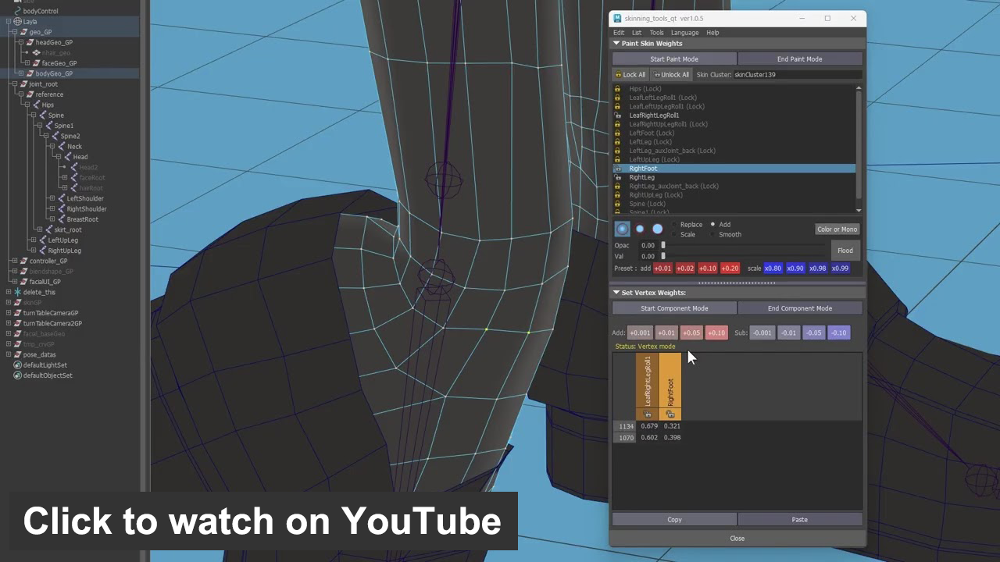
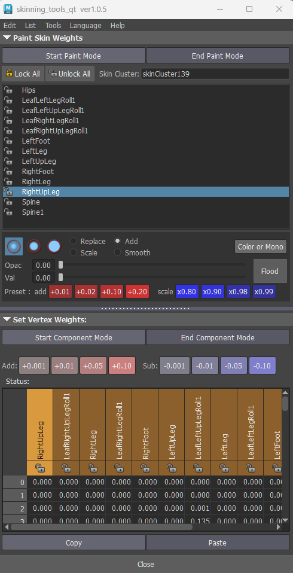
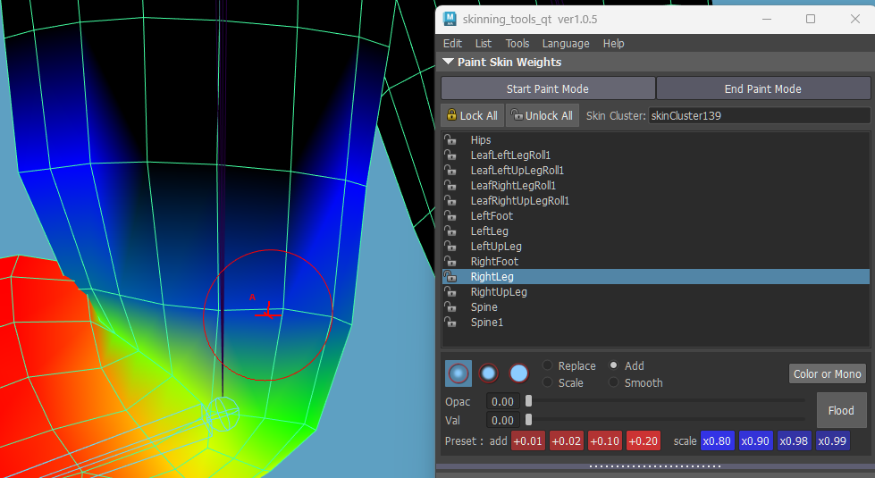
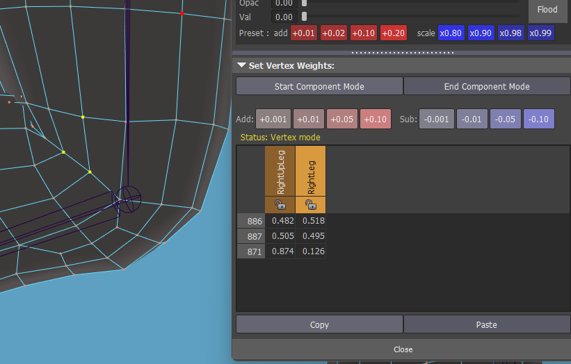
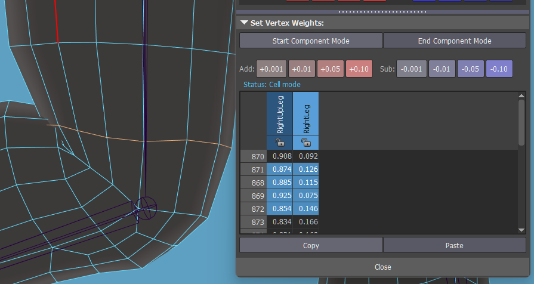

日本語の案内は下部にあります。スクロールしてください。(Japanese information is available below. Please scroll down.)

English
===

skinning_tools_qt - All your Maya skin weight work in one window

skinning_tools_qt is a Python tool for fine-tuning skin weights in Maya, all in one place.
It is especially effective for skin weight work with a limited maximum number of influences, such as for mobile.

Main features include:
　Paint weights with a brush
　Add / subtract the weights of selected vertices
　Type weight values directly
　Copy / paste vertex weights

A detailed manual is also available from the Help menu.

■ Three ways to adjust skin weights

1. Paint with a brush
   Drive Maya's Paint Skin Weights tool with an influence list and presets.
   Preset buttons ("add +0.01 to +0.20", "scale x0.80 to x0.99") set the operation and value in one click.
   Good for roughing in and smoothing large areas.

2. Select vertices and nudge their weights with buttons
   Keep a joint bent, select vertices, and press +0.001 to +0.10 / -0.001 to -0.10.
   The mesh deformation updates on every click, so you can fine-tune while watching the edge loops.

3. Type values in the weight table
   The weights of the selected vertices are listed in a table (rows = vertices, columns = influences).
   Select cells and type a value to set it on all selected cells at once.
   When normalization is on, the other influences are adjusted automatically, keeping their ratio.

■ Others
  * Switch the UI between English and Japanese
  * HTML manuals in English and Japanese (open them from the tool's Help menu)

■ Requirements

- Autodesk Maya 2022 or later (Windows)
- Supports both PySide2 (Maya 2022 to 2024) and PySide6 (Maya 2025 and later)

■ What's included

- skinning_tools_qt.py ................ The tool (Python script)
- skinning_tools_qt_manual_Eng.html ... Manual (English)
- skinning_tools_qt_manual_Jpn.html ... Manual (Japanese)

■ How to start

Put the three files in the same folder, and run the following in the Python tab of Maya's Script Editor
(replace path with the location of skinning_tools_qt.py).

path = r"C:/tools/skinning_tools_qt.py"
with open(path, encoding="utf-8") as f:
    exec(compile(f.read(), path, "exec"))

Adding it to a shelf button is convenient.

■ Notes

- The tool uses the order in which you select vertices, so it turns on Maya's "Track selection order"
  (selectPref -trackSelectionOrder) when it starts. This is a Maya-wide setting and stays on after you close the tool.
- Objects with several shapes under one transform may give unexpected results.

created by gadget-design T.Kondo
http://www.gadget-design.com

_______________________
日本語
===

skinning_tools_qt ― Maya のスキンウェイト作業を、ひとつのウィンドウで

skinning_tools_qt は、Maya のスキンウェイト調整をまとめて細かく調整するための Python ツールです。
MAXインフルエンス数の制限のあるモバイル向けなどのスキニング・ウェイト調整に効果的です。

主な機能としては、以下のものがあります。
　ブラシでのペイント
　選択した頂点のウェイトの増減
　数値でウェイトを直接入力
　頂点ウェイトのコピー / ペースト

詳細なHELPメニューもあります。

■ 3 種類のウェイト調整方法を使い分け

1. ブラシで塗る
   Maya 標準のスキンウェイトペイントツールを、インフルエンスリストとプリセット付きで操作します。
   「加算 +0.01〜+0.20」「乗算 x0.80〜x0.99」のプリセットボタンで、操作と値をワンクリックで切り替え。
   広い範囲を大まかに整えたり、なめらかにしたりするのに向いています。

2. 頂点を選んで、ボタンでウェイトを足し引きする
   ジョイントを曲げて変形させたまま、頂点を選んで +0.001〜+0.10 / -0.001〜-0.10 のボタンを押すだけ。
   押すたびにメッシュの変形がすぐ変わるので、エッジループの流れを見ながら細かく直せます。

3. ウェイト表で数値を直接入力する
   選んだ頂点のウェイトを表（行 = 頂点、列 = インフルエンス）で一覧表示。
   セルを選んで数値を入力すると、選択中のすべてのセルに同じ値が入ります。
   正規化が ON のときは、ほかのインフルエンスを元の比率のまま自動で調整します。

■ その他
  ・画面の表示を日本語 / 英語で切り替え
  ・日本語 / 英語の HTML マニュアル付き（ツールの Help メニューから開けます）

■ 動作環境

- Autodesk Maya 2022 以降（Windows）
- PySide2（Maya 2022〜2024） / PySide6（Maya 2025 以降）の両方に対応

■ 内容物

- skinning_tools_qt.py ………………… ツール本体（Python スクリプト）
- skinning_tools_qt_manual_Jpn.html … マニュアル（日本語）
- skinning_tools_qt_manual_Eng.html … マニュアル（英語）

■ 起動方法

3 つのファイルを同じフォルダに置き、Maya のスクリプトエディタの Python タブで次を実行します
（path は skinning_tools_qt.py を置いた場所に書き換えてください）。

path = r"C:/tools/skinning_tools_qt.py"
with open(path, encoding="utf-8") as f:
    exec(compile(f.read(), path, "exec"))

シェルフのボタンに登録しておくと便利です。

■ ご注意

- 頂点を選択した順を使うため、起動時に Maya の「選択順の記録」（selectPref -trackSelectionOrder）を ON にします。
  Maya 全体の設定なので、ツールを閉じても ON のままです。
- 1 つのトランスフォームの下に複数のシェイプがあるオブジェクトでは、意図しない結果になることがあります。

created by gadget-design T.Kondo
http://www.gadget-design.com
